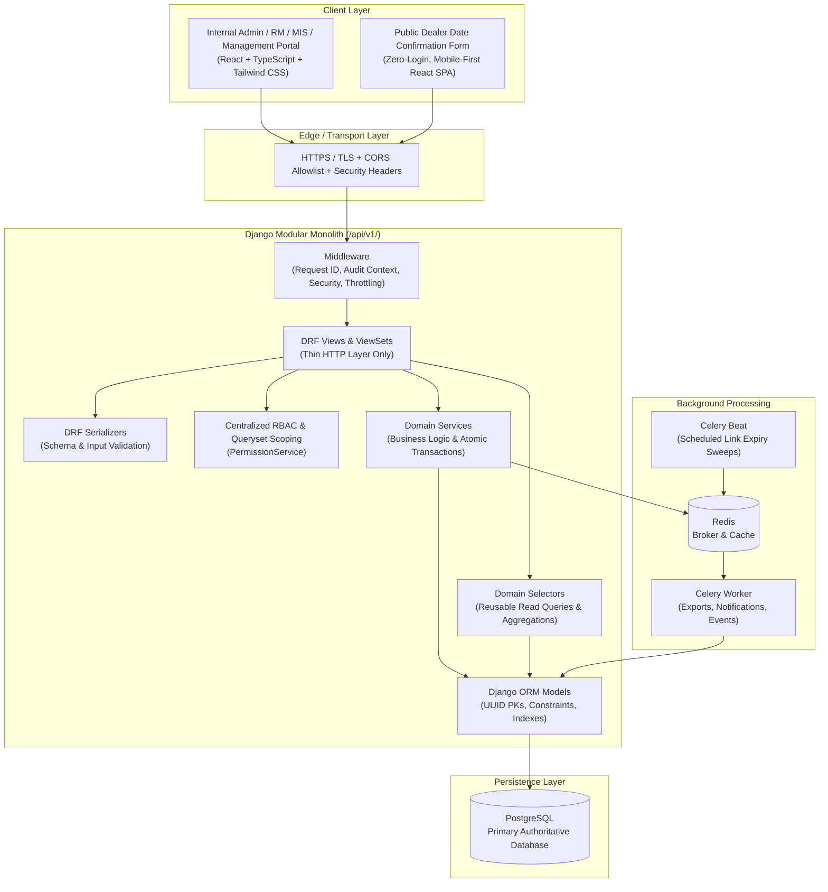
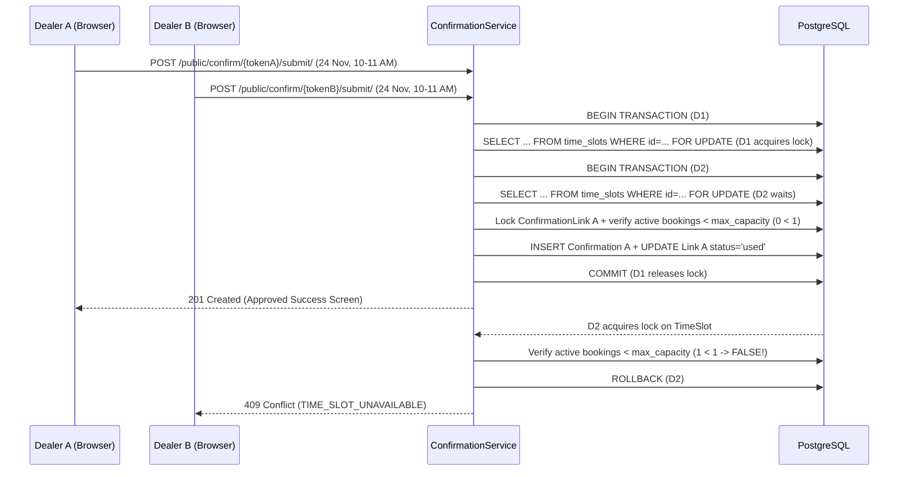

# System Architecture — Havells Sambandh

| Field | Value |
| :--- | :--- |
| **Document Version** | 1.0.0 |
| **Phase** | Phase 03 — System Architecture |
| **Architecture Style** | Modular Monolith (Backend) + Decoupled SPA (Frontend) |
| **API Style** | Versioned REST API (`/api/v1/`) with OpenAPI 3.0 Schema |
| **Primary Database** | PostgreSQL 16+ |
| **Async / Cache** | Celery + Redis |
| **Last Updated** | 2026-11-23 |

---

## 1. High-Level System Architecture



---

## 2. Backend Layered Design Pattern (Strict Separation of Concerns)

To keep the platform maintainable, testable, and free of duplicated logic, every Django app inside `backend/apps/` follows a strict **5-layer responsibility boundary**:

| Layer | File | Allowed Responsibilities | Strictly Prohibited |
| :--- | :--- | :--- | :--- |
| **1. HTTP Layer** | `views.py` | Parse request via Serializer, enforce DRF Permission classes, invoke a Service or Selector, return standardized API response | Direct complex ORM mutations, business rule branching, raw SQL, duplicated validation |
| **2. Validation Layer** | `serializers.py` | Validate request shape, field types, formats (e.g., 10-digit Indian mobile), and serialize output DTOs | Side effects, sending notifications, complex multi-model transactions |
| **3. Authorization Layer** | `common/permissions/` + `apps/permissions/services.py` | Evaluate database-driven RBAC (`module.action`), apply queryset-level RM isolation | Hardcoded role-name `if/else` checks scattered across views |
| **4. Business Logic Layer** | `services.py` | Execute domain workflows, `transaction.atomic()`, `select_for_update()` locking, invoke `AuditService`, emit notification hooks | Constructing HTTP `Response` objects |
| **5. Read / Query Layer** | `selectors.py` | Reusable, optimized ORM queries (`select_related`, `prefetch_related`), RBAC-filtered querysets, dashboard/report aggregations | Mutating database state |
| **6. Data Model Layer** | `models.py` | Schema definition, UUID primary keys, indexes, `UniqueConstraint`, `CheckConstraint`, light model properties | Cross-app workflow orchestration |

---

## 3. Repository & Directory Structure

```text
havells_sambandh/
├── backend/
│   ├── config/
│   │   ├── settings/
│   │   │   ├── base.py          # Shared settings, installed apps, DRF, JWT, Celery, Logging
│   │   │   ├── development.py   # Local dev settings, DEBUG=True, browsable API
│   │   │   ├── production.py    # Hardened HTTPS, secure cookies, WhiteNoise/static, HSTS
│   │   │   └── test.py          # Fast password hasher, eager Celery, isolated test config
│   │   ├── urls.py              # /api/v1/ router, health check, OpenAPI/Swagger endpoints
│   │   ├── celery.py            # Celery app & beat schedule configuration
│   │   ├── asgi.py
│   │   └── wsgi.py
│   ├── apps/
│   │   ├── accounts/            # Custom User model (mobile_number auth), JWT auth, User CRUD
│   │   ├── roles/               # Role & UserRole models and management
│   │   ├── permissions/         # Permission, RolePermission, PermissionService, RBAC seeding
│   │   ├── dealers/             # Dealer master, RM assignment, Excel import/export
│   │   ├── campaigns/           # Campaign lifecycle, timezone, active date windows
│   │   ├── scheduling/          # OperatingHoursConfig, TimeSlot, Holiday, BlockedSlot, Availability
│   │   ├── confirmations/       # ConfirmationLink (hashed tokens), Confirmation, Public API
│   │   ├── dashboard/           # Live KPI & chart aggregation selectors/endpoints
│   │   ├── reports/             # 8 standard reports + OpenPyXL/CSV exporters
│   │   ├── notifications/       # Pluggable provider interface (WhatsApp/SMS/Email/In-App)
│   │   └── audit_logs/          # Immutable AuditLog model, AuditService, secret redaction
│   ├── common/
│   │   ├── exceptions/          # Custom domain exceptions & production-safe DRF exception handler
│   │   ├── middleware/          # Request context (IP, user-agent, request_id) for audit logs
│   │   ├── models/              # Abstract UUIDModel & TimeStampedModel base classes
│   │   ├── pagination/          # StandardPageNumberPagination
│   │   ├── permissions/         # DRF HasModulePermission & RMScopeMixin
│   │   ├── responses/           # Standardized API response envelope helpers
│   │   └── validators/          # Indian mobile validator, dealer code normalizer, upload validator
│   ├── services/                # Cross-cutting infrastructure helpers (Excel sanitizer, token hashing)
│   ├── tests/                   # Pytest fixtures, factories, integration & concurrency tests
│   ├── requirements/
│   │   ├── base.txt
│   │   ├── development.txt
│   │   └── production.txt
│   └── manage.py
├── frontend/
│   ├── src/
│   │   ├── app/                 # App root, QueryClientProvider, AuthProvider, ToastProvider
│   │   ├── api/                 # Axios instance with JWT refresh interceptor & typed API clients
│   │   ├── assets/              # Static assets & brand icons
│   │   ├── components/
│   │   │   ├── ui/              # Reusable design-system primitives (Phase 02 spec)
│   │   │   └── shared/          # BrandLogo, PageHeader, FilterBar, CopyLinkBox, EmptyState
│   │   ├── layouts/             # AdminLayout (sidebar + topbar) & PublicLayout (dealer form)
│   │   ├── pages/               # Route-level page components
│   │   ├── features/            # Domain feature modules (auth, dashboard, users, roles, dealers, etc.)
│   │   ├── hooks/               # Shared hooks (useAuth, usePermissions, useDebounce)
│   │   ├── routes/              # React Router config, ProtectedRoute, PermissionRoute
│   │   ├── schemas/             # Zod validation schemas
│   │   ├── services/            # Client-side formatting, CSV/Excel download triggers
│   │   ├── types/               # Shared TypeScript interfaces & API DTOs
│   │   └── utils/               # Date/timezone helpers, error extractors
│   ├── index.html
│   ├── package.json
│   ├── tailwind.config.ts
│   ├── tsconfig.json
│   └── vite.config.ts
├── docs/                        # PRD, UI Rulebook, Architecture, Schema, API, RBAC, Guides
├── scripts/                     # Build, migration, seed, and backup helper scripts
├── .env.example
└── README.md
```

---

## 4. Standardized API Contract

All `/api/v1/` endpoints return a consistent JSON envelope so the React frontend can handle data, pagination, and errors uniformly:

### Success Response
```json
{
  "success": true,
  "message": "Confirmation submitted successfully.",
  "data": { ... },
  "meta": {
    "pagination": {
      "count": 120,
      "page": 1,
      "page_size": 20,
      "total_pages": 6
    }
  }
}
```

### Error Response (Production-Safe — Never Exposes Stack Traces)
```json
{
  "success": false,
  "error": {
    "code": "TIME_SLOT_UNAVAILABLE",
    "message": "The selected time slot is no longer available. Please choose another slot.",
    "details": {
      "preferred_time_slot": ["Slot capacity has been reached for 2026-11-24."]
    }
  }
}
```

---

## 5. Security & Concurrency Architecture

### 5.1 Authentication & Cookie/Token Flow
- Login (`POST /api/v1/auth/login/`) validates 10-digit `mobile_number` + `password` and issues:
  - Short-lived JWT Access Token (`15 min`)
  - Rotating JWT Refresh Token (`7 days`) stored in an `HttpOnly`, `Secure` (in production), `SameSite=Lax` cookie, with refresh token rotation and blacklisting on logout.
- Frontend Axios client attaches credentials/bearer token automatically and queues concurrent `401` requests during silent refresh.

### 5.2 Public Token Security
- Raw token: `secrets.token_urlsafe(32)` (256-bit cryptographic randomness).
- Stored value: `hashlib.sha256(raw_token.encode()).hexdigest()` in `ConfirmationLink.token_hash` (indexed, unique).
- Public endpoints (`GET/POST /api/v1/public/confirm/<token>/...`) hash the incoming path token and look up `token_hash`, applying DRF scoped rate limiting (`public_confirm_read` and `public_confirm_submit`) to prevent enumeration and abuse.

### 5.3 Concurrency-Safe Booking Flow


---

## 6. Deployment Topology (Render Production Target)

| Component | Service Type | Runtime / Config |
| :--- | :--- | :--- |
| **Frontend SPA** | Render Static Site | `npm ci && npm run build` → serves `frontend/dist/` with SPA rewrite `/* → /index.html` |
| **Backend API** | Render Web Service | Gunicorn (`config.wsgi:application`) + WhiteNoise for admin/schema static assets |
| **Database** | Render Managed PostgreSQL | Automated daily backups, TLS required |
| **Background Worker** | Render Background Worker | `celery -A config worker -l info` + Beat scheduler |
| **Broker / Cache** | Managed Redis | Celery broker, result backend, and DRF rate-limit cache |

---

## 7. Future-Ready Extension Points

1. **Multi-Campaign & Experience Catalog:** `ConfirmationLink` and `Confirmation` already reference `Campaign`; future `experiences` and `budgets` apps can attach to `Campaign` via ForeignKey without breaking v1.0 tables.
2. **Notification Gateways:** `apps/notifications/providers/base.py` defines an abstract `NotificationProvider` interface so WhatsApp Business API, SMS, and SMTP providers can be plugged in via settings without changing domain services.
3. **Multi-Business-Unit Partitioning:** `PermissionService` and queryset scoping mixins are centralized, allowing future BU-level scoping alongside RM scoping.
4. **Automated MIS & AI Reporting:** Report selectors in `apps/reports/selectors.py` are decoupled from HTTP views so Celery scheduled emails or future AI analytics pipelines can invoke them directly.
