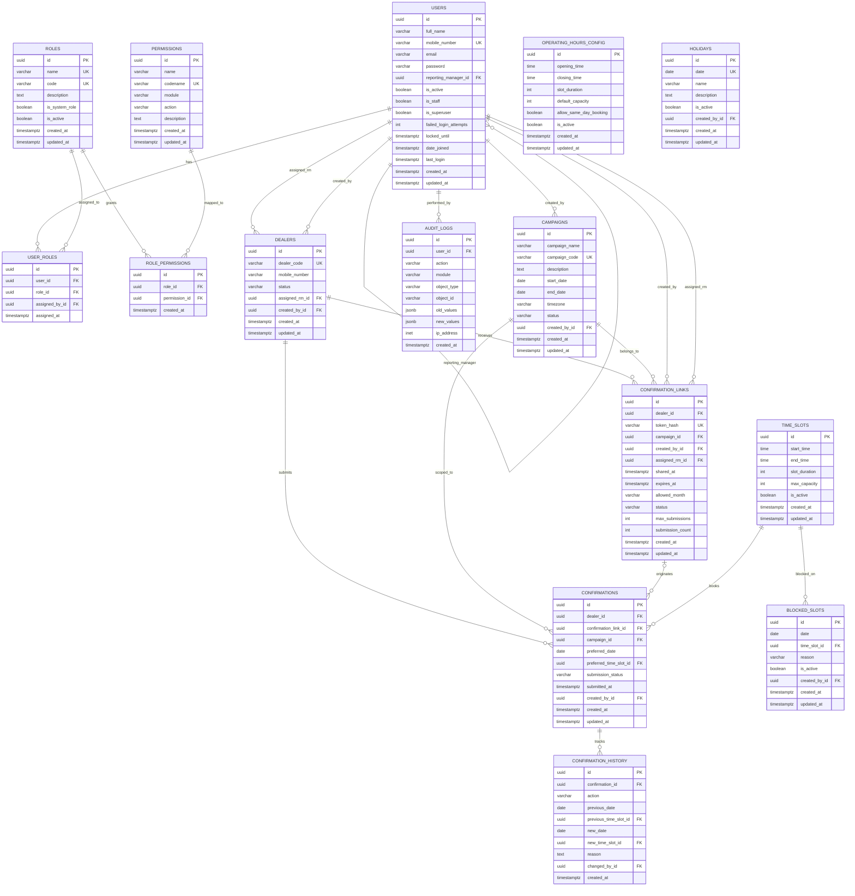

# Database Schema & ER Design — Havells Sambandh

| Field | Value |
| :--- | :--- |
| **Document Version** | 1.0.0 |
| **Phase** | Phase 04 — Database Design |
| **Database Engine** | PostgreSQL 16+ (Primary Development & Production) |
| **Primary Key Strategy** | UUID v4 (`UUIDField`) across all business entities |
| **Timestamp Strategy** | UTC `TIMESTAMPTZ` (`created_at`, `updated_at`); business dates evaluated in campaign timezone (`Asia/Kolkata`) |
| **Last Updated** | 2026-11-23 |

---

## 1. Entity-Relationship (ER) Diagram

---

## 2. Table Specifications, Constraints & Indexes

### 2.1 `accounts_user` (Custom Django User Model)
- **Purpose:** Primary internal identity table. `USERNAME_FIELD = "mobile_number"`.
- **Constraints:**
  - `mobile_number`: `UNIQUE`, 10-digit Indian mobile number (`^[6-9]\d{9}$`).
  - `email`: Optional (`NULL` allowed); normalized lowercase if provided.
  - `failed_login_attempts >= 0`.
- **Indexes:** `mobile_number` (unique), `is_active`, `reporting_manager_id`.

### 2.2 `roles_role` & `roles_userrole`
- **`roles_role`:** `name` (`UNIQUE`), `code` (`UNIQUE`, indexed), `is_system_role`, `is_active`.
- **`roles_userrole`:** `UNIQUE(user_id, role_id)` preventing duplicate assignment of the same role to a user. Supports multi-role assignment with clear union-based permission resolution.

### 2.3 `permissions_permission` & `permissions_rolepermission`
- **`permissions_permission`:** `codename` (`UNIQUE`, format `<module>.<action>`, e.g., `dealers.import`), `module` (indexed), `action` (indexed).
- **`permissions_rolepermission`:** `UNIQUE(role_id, permission_id)`.

### 2.4 `dealers_dealer`
- **Purpose:** Internal master directory of Havells dealers. Does NOT store dealer name for the public confirmation form.
- **Constraints:**
  - `dealer_code`: `UNIQUE`, trimmed & uppercase-normalized.
  - `mobile_number`: 10-digit Indian mobile number, indexed for search/validation.
  - `status`: `active` | `inactive`.
- **Indexes:** `dealer_code` (unique), `(assigned_rm_id, status)`, `mobile_number`.

### 2.5 `campaigns_campaign`
- **Purpose:** Engagement campaign container (supports future multi-campaign expansion).
- **Constraints:**
  - `campaign_code`: `UNIQUE`, uppercase-normalized.
  - `CHECK (end_date >= start_date)`.
- **Indexes:** `campaign_code` (unique), `status`, `(start_date, end_date)`.

### 2.6 `scheduling_timeslot`, `scheduling_operatinghoursconfig`, `scheduling_holiday`, `scheduling_blockedslot`
- **`scheduling_timeslot`:**
  - `UNIQUE(start_time, end_time)`
  - `CHECK (end_time > start_time)`
  - `CHECK (slot_duration > 0)`
  - `CHECK (max_capacity >= 1)`
- **`scheduling_holiday`:** `date` (`UNIQUE`), `is_active`.
- **`scheduling_blockedslot`:** `UNIQUE(date, time_slot_id)`, indexed on `(date, is_active)`.

### 2.7 `confirmations_confirmationlink`
- **Purpose:** Personalized, hashed confirmation link mapping a dealer + campaign + `allowed_month`.
- **Security:** Stores ONLY SHA-256 hex digest (`token_hash`, 64 chars, `UNIQUE`). Never stores plain-text tokens.
- **Constraints:**
  - `token_hash`: `UNIQUE`.
  - `CHECK (max_submissions >= 1)`.
  - `CHECK (submission_count >= 0 AND submission_count <= max_submissions)`.
- **Indexes:** `token_hash` (unique), `(dealer_id, campaign_id, status)`, `(assigned_rm_id, status)`, `allowed_month`, `expires_at`.

### 2.8 `confirmations_confirmation` & `confirmations_confirmationhistory`
- **`confirmations_confirmation`:**
  - **Partial Unique Index (`uq_active_confirmation_per_link`):** `UNIQUE(confirmation_link_id) WHERE confirmation_link_id IS NOT NULL AND submission_status = 'confirmed'` — prevents duplicate active confirmations for the same link at the database layer.
  - **Indexes:** `(preferred_date, preferred_time_slot_id, submission_status)` (critical for fast capacity counts & locking), `(dealer_id, submitted_at)`, `(campaign_id, submission_status)`.
- **`confirmations_confirmationhistory`:** Immutable ledger of every reschedule or cancellation with actor, old/new date+slot, and reason.

### 2.9 `audit_logs_auditlog`
- **Purpose:** Immutable compliance log of all critical actions.
- **Indexes:** `(module, action)`, `(object_type, object_id)`, `(user_id, created_at)`, `created_at`.
- **JSONB Columns:** `old_values`, `new_values` (automatically redacted of passwords, tokens, and hashes before insert).

---

## 3. Concurrency & Integrity Guarantees

1. **Zero Overbooking:** Booking creation and rescheduling acquire a PostgreSQL row lock (`TimeSlot.objects.select_for_update().get(pk=slot_id)`) inside `transaction.atomic()`, count active `Confirmation` rows for `(preferred_date, preferred_time_slot)`, and abort with `409 Conflict` if `count >= time_slot.max_capacity`.
2. **Zero Duplicate Link Submissions:** `ConfirmationLink.objects.select_for_update()` serializes concurrent submissions on the same token, backed by the partial unique index `uq_active_confirmation_per_link`.
3. **Referential Protection:** Critical foreign keys (`dealer`, `campaign`, `time_slot`, `assigned_rm`) use `on_delete=models.PROTECT` (or `SET_NULL` for optional actor references) so soft-deactivation is enforced and historical audit/report integrity is never broken by cascading deletes.
